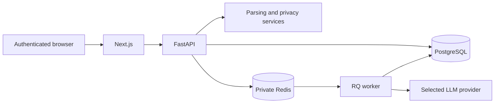

# Two-Minute Architecture Walkthrough

TruthFit is an evidence-based resume and job-fit review product. The current product path uses a Next.js frontend, a FastAPI service layer, PostgreSQL persistence, Supabase authentication, and Redis with RQ for production analysis jobs. Streamlit remains a temporary legacy demo while the product stack is being deployed.

The workflow starts when an authenticated person uploads a resume and adds a job description. FastAPI streams and bounds the upload before shared loaders extract text. Personal contact details are redacted before provider processing, and the original resume remains transient unless encrypted retention is explicitly enabled.

Creating an analysis is idempotent and account-scoped. The API checks the authenticated Supabase subject, consumes one daily quota unit atomically, records the current consent, prompt, and schema versions, and commits a pending analysis. Local development uses a FastAPI background task; production sends the redacted payload to an RQ worker through private Redis. This keeps provider latency outside the request transaction.

The worker builds a prompt that treats the resume and job description as untrusted data. Provider output must validate against nested Pydantic models with unknown fields forbidden. A valid result is normalized, scored for evidence quality, and persisted with provider usage, latency, and evidence records. A provider, parsing, or schema failure marks the run failed instead of manufacturing a zero-score result.

PostgreSQL stores users, redacted resumes, jobs, analysis runs, evidence, operational events, normalized skill gaps, and atomic daily usage. Every read and mutation includes the authenticated owner ID. Alembic is the schema source of truth; durable environments refuse to start when their database revision is behind.

The Next.js product turns the result into Apply Readiness, requirement evidence, score drivers, grounded rewrites, and a Kanban job tracker. Users can inspect retention settings and delete an analysis or all application data. CI verifies unit, authorization, prompt-injection, PostgreSQL, browser, load, and versioned LLM-evaluation paths.

The main limitation is deployment, not architecture: the Next.js/FastAPI stack still needs a stable public environment, production monitoring, and a completed backup/restore drill before it should be called a public beta.

## Diagram

